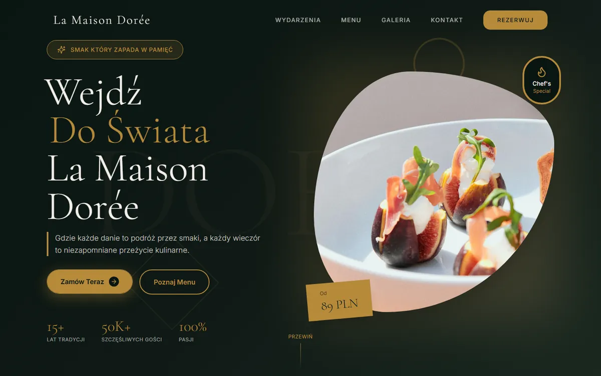
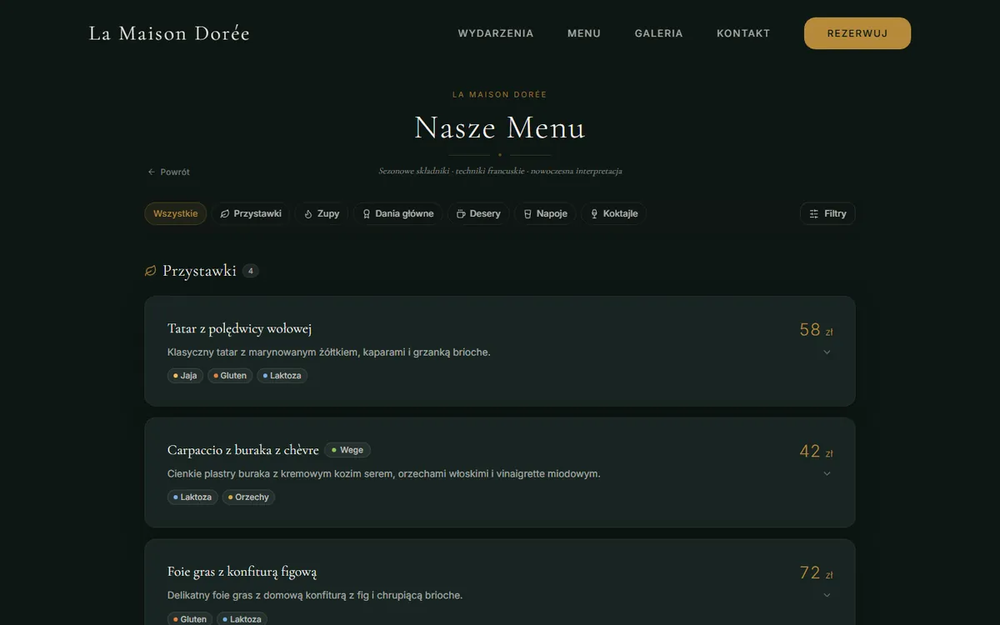
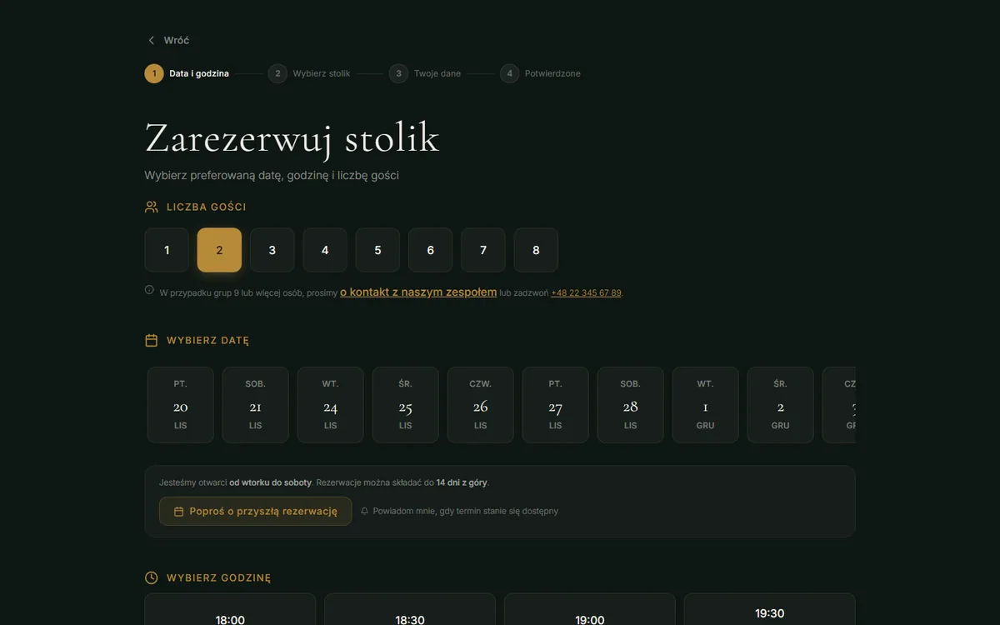
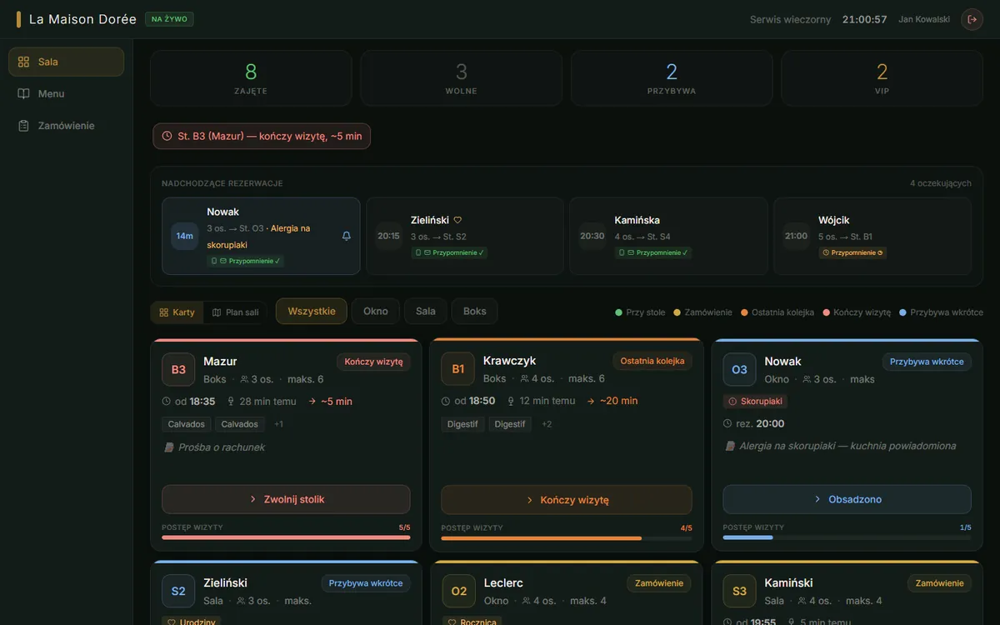
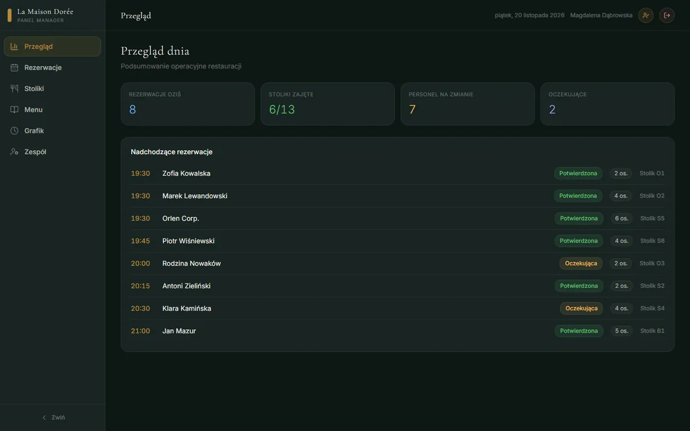
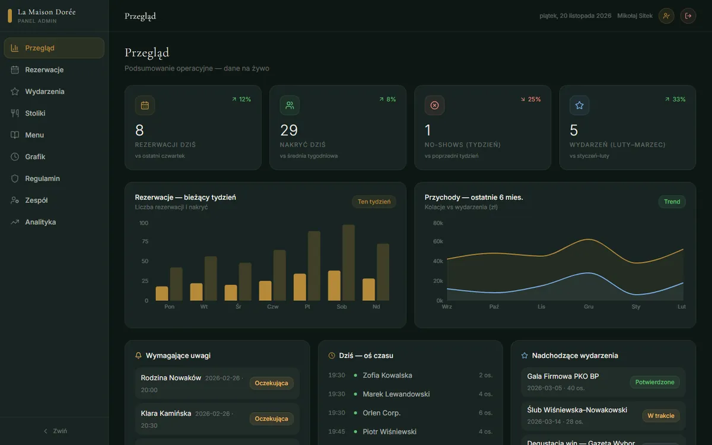
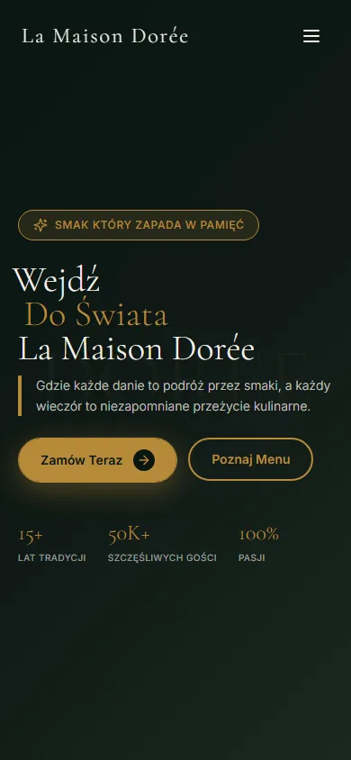
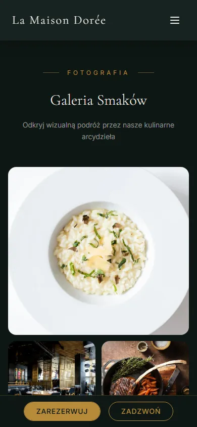
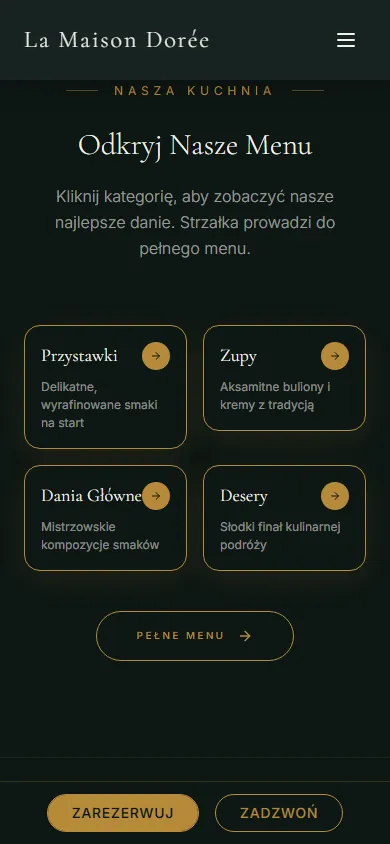

# La Maison Dorée

**Demonstracyjna aplikacja restauracji: od wyboru stolika przez gościa po panele kelnera, menedżera i administratora.**

**Strona: [restaurant-design-ten.vercel.app](https://restaurant-design-ten.vercel.app)**

Restauracja jest fikcyjna — rezerwacje, płatności i dane operacyjne służą prezentacji interfejsu.

[](https://github.com/Sitkowski01/restaurant-booking-panels/actions/workflows/ci.yml)



## Po co to jest

Gość poznaje restaurację i przechodzi przez wybór terminu, stolika oraz danych kontaktowych.
Personel ma osobne widoki do obsługi sali, planowania zmiany i konfiguracji lokalu.

**Część dla gościa**

- Strona główna z galerią coverflow i opisem restauracji, karta menu i wydarzenia prywatne.
- **Rezerwacja w czterech krokach:** data i godzina → plan sali → dane gościa → potwierdzenie.
- Dobór stolika do liczby gości, oznaczenia zajętych miejsc i naliczanie depozytu od osoby.
- Walidacja danych kontaktowych, zgody na przetwarzanie danych oraz pól BLIK i karty.
- Zgoda na pliki cookie i strona 404 dla nieistniejących adresów.

**Panel kelnera — obsługa sali**

- Plan sali z podziałem na sekcje i przeciąganiem stolików.
- Statusy stolików, nadchodzące rezerwacje i obsługa gości bez rezerwacji.
- Zamówienia z karty: dania, napoje, dobór win i dolewki.
- Oznaczanie napojów jako podanych i kontrola wydania zamówienia.
- Alergeny gościa, własne wpisy i informacja o powiadomieniu kuchni.

**Panel menedżera — bieżąca zmiana**

- Rezerwacje z filtrami oraz podsumowania dnia i tygodnia.
- Edytowalny grafik zmian i podgląd zespołu.
- Przegląd stolików i ich dostępności.
- Edycja karty: dania, składniki, kategorie, alergeny i oznaczenia alkoholu.

**Panel administratora — konfiguracja lokalu**

- Edycja personelu: role, stanowiska, umowy, aktywacja i dezaktywacja wpisów.
- Edycja karty dań i napojów, kategorii i alergenów.
- Podgląd wydarzeń, rezerwacji na wyłączność i zasad anulacji z opłatami.
- Grafik oraz analityka przychodów, zestawienia tygodniowe i miesięczne, aktywność personelu.

Zmiany w panelach działają na lokalnym stanie komponentów. Edycja personelu nie tworzy
konta w systemie logowania, a widok polityki anulacji nie pobiera opłat.

| **Karta menu** | **Wybór terminu rezerwacji** |
|---|---|
|  |  |
| **Panel kelnera** | **Panel menedżera** |
|  |  |
| **Panel administratora** | |
|  | |

### Na telefonie

| **Start** | **Galeria** | **Menu** |
|---|---|---|
|  |  |  |

## Co jest w środku

**Front:** React, TypeScript, Vite, Tailwind CSS i React Router. Repozytorium zawiera
komponenty shadcn/ui oparte na Radix UI oraz zależności Material UI.

**Rezerwacja w demo:** kolejne ekrany przekazują dane przez stan routingu.
Formularz kończy się przejściem do potwierdzenia — nie wysyła rezerwacji do Supabase
i nie obciąża karty ani konta BLIK.

**Backend w repozytorium:** funkcja Supabase Edge z routerem Hono udostępnia operacje
na stolikach i rezerwacjach w magazynie klucz–wartość. Obecne widoki demonstracyjne
nie wywołują tych endpointów. Konfiguracja klienta czyta zmienne środowiskowe.

**Logowanie i role:** lista kont demonstracyjnych znajduje się w kodzie.
Sesja trafia do `sessionStorage`, a `RequireAuth` kontroluje przejścia między trasami
w przeglądarce. To demonstracja ról, nie uwierzytelnianie po stronie serwera.

### Dane do paneli demo

Otwórz [logowanie personelu](https://restaurant-design-ten.vercel.app/login)
i wpisz imię, nazwisko oraz PIN:

| Rola | Imię i nazwisko | PIN | Panel |
|---|---|---|---|
| Kelner | Jan Kowalski | `111111` | `/staff-dashboard` |
| Menedżer | Magdalena Dąbrowska | `666666` | `/manager` |
| Administrator | Mikołaj Sitek | `000000` | `/admin` |

Przed sprawdzeniem innej roli wyloguj się przyciskiem w panelu.

### Decyzje projektowe

**Klucz rezerwacji niesie datę i godzinę.** Backend zapisuje
`reservation:{data}:{godzina}:{id}`, a stoliki pod `table:{id}`. Odczyt rezerwacji
na termin korzysta z prefiksu; wyszukiwanie po gościu wymagałoby osobnego indeksu.

**Plan sali jest danymi.** Stoliki mają pozycję, rozmiar i kształt. W panelu kelnera
przeciąganie zmienia stan widoku; obecna wersja nie zapisuje tego ustawienia na serwerze.

**Dopasowanie stolika jest przedziałem.** Pojemność musi mieścić się w zakresie
`[liczba gości, liczba gości + 2]`. Pozwala to posadzić trzy osoby przy stoliku
czteroosobowym, bez proponowania parze stołu na osiem osób.

**Osobne panele dla różnych zadań.** Rola wybiera trasę i widok. Menedżer może wejść
także do panelu kelnera, a administrator do wszystkich paneli.

**Testy zbudowanej aplikacji.** Playwright korzysta z `vite preview`, a selektory
opierają się na `data-testid`, dzięki czemu nie zależą od klas Tailwinda.

### Testy i ciągła integracja

| Plik | Zakres |
|---|---|
| `e2e/reservation-flow.spec.ts` | Przejście czterech kroków, przekazanie danych, depozyt od osoby, blokada bez terminu, pojemność i zajętość stolików |
| `e2e/guest-details-validation.spec.ts` | Imię, e-mail, telefon, zgoda, kod BLIK, formatowanie i walidacja karty, demonstracyjne potwierdzenie płatności |
| `e2e/staff-access.spec.ts` | Logowanie ról, błędny PIN, ochrona tras, przekierowania aktywnej sesji i 404 |

Konfiguracja uruchamia zestaw w Chromium, a przypadki oznaczone `@mobile` także
w profilu Pixel 7. Reguły doboru stolików i dostępu według roli mają osobne sprawdzenia.

Workflow `.github/workflows/ci.yml` działa dla pushów i pull requestów do `main`
oraz `master`, a także ręcznie. Instaluje zależności, buduje aplikację, instaluje
Chromium i uruchamia Playwrighta. Raport HTML jest przechowywany przez 14 dni.

### Zakres i dalszy rozwój

Demo obejmuje ekrany od rezerwacji po obsługę i konfigurację lokalu.
Kolejny krok to połączenie widoków z trwałymi danymi, serwerowe konta personelu
oraz integracja płatności. Relacyjna baza pozwoliłaby dodać unikalne ograniczenie
na stolik i termin oraz raporty liczone po stronie bazy. Obecny backend sprawdza
zajętość przed zapisem, lecz nie wykonuje tych operacji atomowo.

**Pochodzenie i zależności:** szkielet pochodzi z Figma Make, komponenty bazowe
z shadcn/ui na licencji MIT, a zdjęcia z Unsplash. Szczegóły:
[ATTRIBUTIONS.md](ATTRIBUTIONS.md).

## Uruchomienie

```bash
npm ci
npm run dev              # lokalne demo
npm run build            # build do dist/
npm run preview          # podgląd na http://localhost:4173
npm run test:e2e         # zestaw Playwrighta; wymaga zainstalowanego Chromium
npm run test:e2e:ui      # interaktywny tryb testów
npm run test:e2e:report  # ostatni raport HTML
```

Do samego demo nie trzeba konfigurować Supabase. Przy podłączaniu backendu
skopiuj `.env.example` do `.env` i uzupełnij `VITE_SUPABASE_PROJECT_ID`
oraz `VITE_SUPABASE_ANON_KEY`. Funkcje serwerowe wymagają osobnego uruchomienia
w Supabase i zmiennych `SUPABASE_URL` oraz `SUPABASE_SERVICE_ROLE_KEY`.

## Struktura

```text
src/app/
  pages/               strona restauracji, rezerwacja i panele personelu
  components/          komponenty wspólne i biblioteka UI
  routes.tsx           trasy i kontrola ról w przeglądarce
src/styles/            style aplikacji
supabase/functions/    backend Edge i magazyn klucz–wartość
utils/supabase/        konfiguracja ze zmiennych środowiskowych
e2e/                   scenariusze Playwrighta i wspólne kroki
.github/workflows/     CI: build i testy
docs/zrzuty/           zrzuty na komputerze i telefonie
```

Licencja: MIT

---

Projekt i wykonanie: **Mikołaj Sitek** · [sitekmikolaj.pl](https://sitekmikolaj.pl) · [sitekmikolaj01@gmail.com](mailto:sitekmikolaj01@gmail.com)
